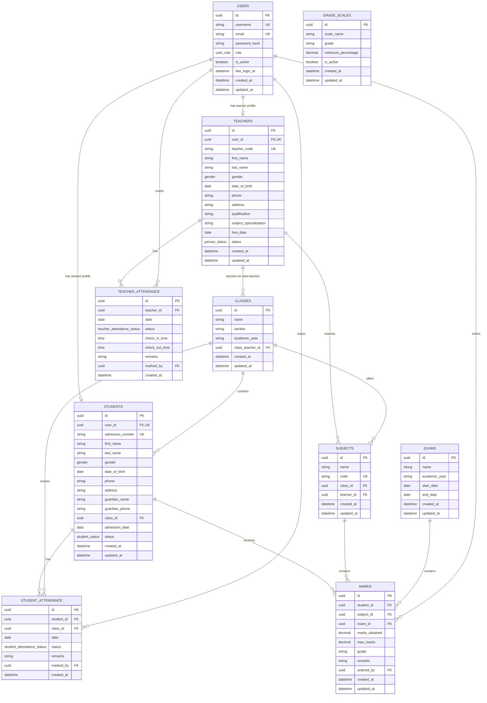

# School Management System: ER diagram

## Recommended stack

- **Next.js App Router + Tailwind CSS** provides one deployable application with
  server-rendered pages, route handlers, and a responsive UI without splitting
  the frontend and backend into separate projects.
- **PostgreSQL + Prisma** is a strong fit for the relational constraints,
  composite uniqueness requirements, reporting queries, and type-safe access
  from TypeScript. Passwords will be stored as Argon2id hashes and sessions
  will be stored server-side.

## ER diagram

## Relationship summary

- A **user** may be an administrator without a profile, or have exactly one
  teacher or student profile. `teachers.user_id` and `students.user_id` are
  both non-null and unique, enforcing the one-to-one profile links.
- A **class** can have one optional class teacher and contains many students.
  A student belongs to one class at a time; historical transfers can be added
  later without changing the current enrollment field.
- A **subject** belongs to one class and is assigned to one teacher. The
  composite class/subject/teacher ownership is enforced by authorization
  rules in the API, while the foreign keys preserve referential integrity.
- **Teacher attendance** is unique per teacher and date. **Student attendance**
  is unique per student and date and records the class used when it was
  marked, which preserves reporting context.
- A **mark** belongs to one student, subject, and exam. The composite
  `(student_id, subject_id, exam_id)` constraint prevents duplicate entries.
  Database checks prevent negative marks or marks above `max_marks`.
- **Grade scales** hold configurable minimum percentage thresholds. The marks
  service selects the active rule with the highest threshold not exceeding the
  percentage, then persists the resulting grade for stable historical reports.
- People are deactivated through status fields. Restrictive foreign keys avoid
  accidentally deleting records that are needed for historical attendance or
  marks.

