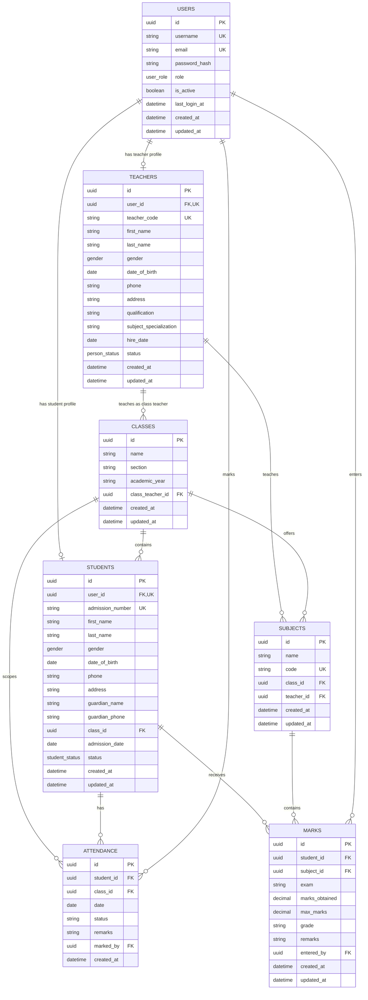

# School Management System: ER Diagram

## Database Schema (Matching Supabase Tables)

The database schema matches the 7 primary tables in the Supabase Table Editor:
1. `attendance`
2. `classes`
3. `marks`
4. `students`
5. `subjects`
6. `teachers`
7. `users`

## ER Diagram

## Tables Overview

- **`users`**: Authentication credentials, roles (`admin`, `teacher`, `student`), and account status.
- **`teachers`**: Teacher records linked to users, qualifications, hire date, and class teacher assignments.
- **`students`**: Student records linked to classes, admission numbers, guardian contacts, and status.
- **`classes`**: Grade, section, academic year, and assigned class teacher.
- **`subjects`**: Course subject details, subject code, class assignment, and assigned teacher.
- **`attendance`**: Daily attendance records per student and class with status (Present, Absent, Late, Excused).
- **`marks`**: Academic assessments, subject marks obtained, maximum marks, exam name, and calculated grade.
